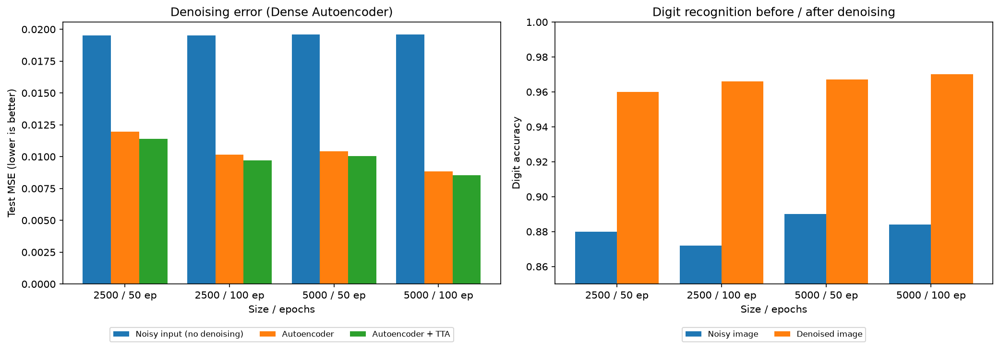
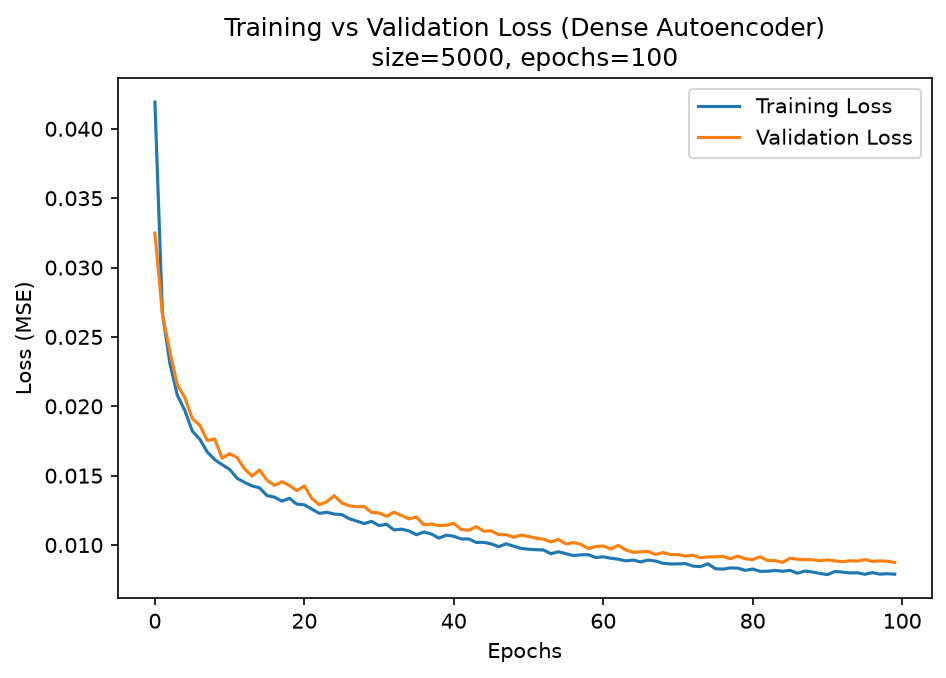
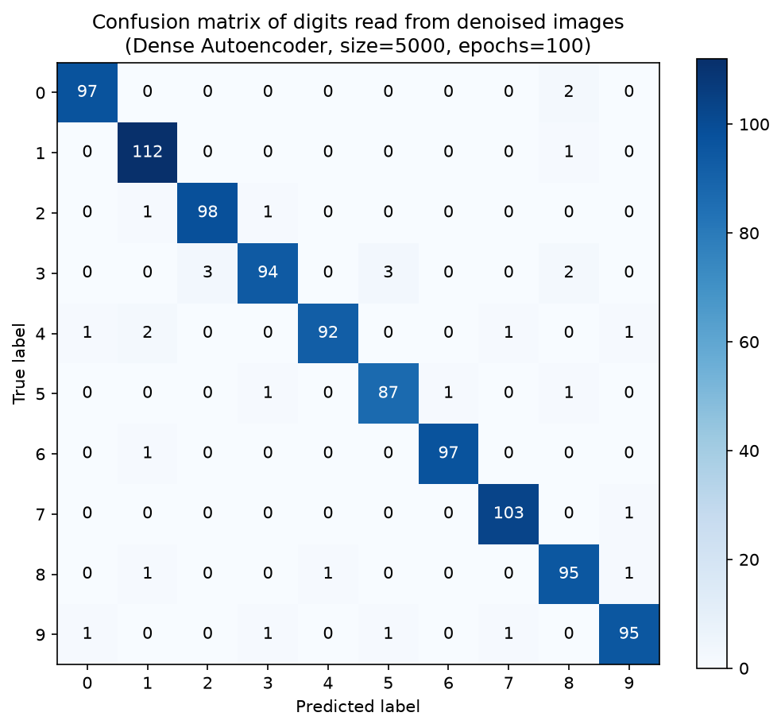
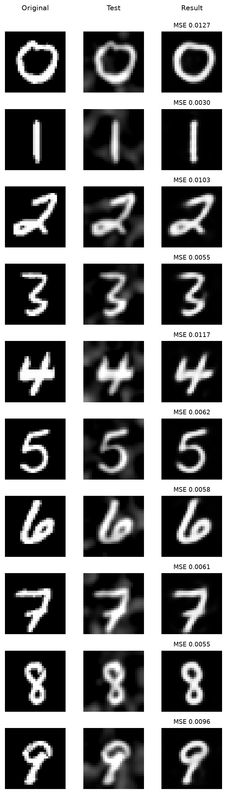

# Denoising Handwritten Digits with a 4-Layer Dense Autoencoder on Small MNIST Subsets

**Author:** Los
**Keywords:** denoising autoencoder, MNIST, dense neural network, gradient noise, test-time augmentation, PSNR

---

## Abstract

This project trains a standard four-layer dense autoencoder (784 → 512 → 256 → 512 → 784) to remove 15 % smooth gradient noise from handwritten digits, using only **2,500 or 5,000** images drawn from the 70,000-image MNIST collection. Four configurations (2 subset sizes × 2 training lengths) are compared using test mean squared error (MSE), peak signal-to-noise ratio (PSNR), and the digit accuracy of a helper classifier that reads the restored images. The best configuration (5,000 images, 100 epochs) lowers test MSE from **0.01959** (noisy input) to **0.00854**, reaches **20.68 dB** PSNR, and lifts helper-classifier accuracy from **88.4 %** on noisy images to **97.0 %** on denoised images. Test-time augmentation (TTA) over one-pixel shifts gives a further consistent gain.

---

## Table of Contents

1. [Introduction](#1-introduction)
2. [Background](#2-background)
3. [System Architecture](#3-system-architecture)
4. [Evaluation](#4-evaluation)
5. [Conclusion](#5-conclusion)
6. [Reference](#6-reference)
7. [Reproducibility](#7-reproducibility)

---

## 1. Introduction

Image denoising restores a clean signal from a corrupted observation. It is a classic use of autoencoders because the network can learn a compressed representation that keeps the digit structure and discards noise. Deep models are usually trained on large datasets, but many practical settings only have a few thousand examples.

This project asks:

> **How well can a plain dense autoencoder remove smooth gradient noise from digits when trained on only 2,500 or 5,000 images, and how much do more data and more epochs help?**

**Contributions**

- A reproducible, seeded (42) experiment over two subset sizes and two epoch budgets.
- A noise model for 15 % smooth, low-frequency gradient noise plus slight blur.
- Training with random corruption and geometric augmentation, so the network sees varied noise.
- Test-time augmentation over the image and its eight one-pixel shifts.
- Evaluation beyond pixel error: a helper classifier and confusion matrix show whether digits remain recognizable after denoising.

---

## 2. Background

### 2.1 Autoencoders
An autoencoder is a neural network trained to reproduce its input through a narrow bottleneck, forcing it to learn a compact representation (Hinton & Salakhutdinov, 2006). A **denoising** autoencoder receives a corrupted input but is trained to output the clean version, so it learns to remove the corruption rather than copy it (Vincent et al., 2008).

### 2.2 Training components used
- **Adam optimizer** (Kingma & Ba, 2014) with learning rate 0.01. Plain SGD at 0.01 did not train this network in preliminary tests.
- **Batch normalization** (Ioffe & Szegedy, 2015) after each hidden dense layer for stable training.
- **Cosine learning-rate decay** (Loshchilov & Hutter, 2017) over all training steps.

### 2.3 Evaluation measures
- **MSE** between the restored image and the clean original (lower is better).
- **PSNR** = 10·log₁₀(1 / MSE) in decibels (higher is better) (Hore & Ziou, 2010).
- **Digit accuracy** from a helper classifier. An autoencoder does not predict digits, so a small classifier reads the images to show how recognizable they remain.

### 2.4 Dataset
MNIST (LeCun et al., 1998): 60,000 training and 10,000 test images are merged into 70,000 grayscale 28×28 images scaled to [0, 1].

---

## 3. System Architecture

### 3.1 Pipeline overview

```
MNIST (70,000 images, train + test merged)
        │
        ▼
 Stratified subset (2,500 or 5,000, seed 42)
        │
        ▼
 Stratified split: 70 % train / 20 % test / 10 % validation
        │
        ├── Train:  random affine augmentation → random noise + blur → model → MSE vs clean target
        ├── Test:   +15 % gradient noise + slight blur (fixed seed)
        └── Val:    +15 % gradient noise (NOISY_VALIDATION = True)
        │
        ▼
 Dense Autoencoder → denoised image (+ TTA over 9 shifts)
        │
        ▼
 Metrics: MSE, PSNR, helper-classifier accuracy, confusion matrix
```

### 3.2 Data split

| Subset size | Train (70 %) | Test (20 %) | Validation (10 %) |
|---|---|---|---|
| 2,500 | 1,750 | 500 | 250 |
| 5,000 | 3,500 | 1,000 | 500 |

Both the subset and the split are stratified by digit class, with seed 42.

### 3.3 Noise model
Smooth (low-frequency) Gaussian noise is generated, blurred with σ = 2.0, rescaled so its standard deviation equals the noise level (**0.15** of the intensity range), added to the image, lightly blurred (σ = 0.8) and clamped to [0, 1].

During training, noise strength is randomized between 0.05 and 0.25, and an extra blur is applied with probability 0.8, so the model does not overfit one noise setting.

### 3.4 Model

| Layer | Shape | Extras |
|---|---|---|
| Dense 1 (encoder) | 784 → 512 | BatchNorm, ReLU |
| Dense 2 (bottleneck) | 512 → 256 | BatchNorm, ReLU |
| Dense 3 (decoder) | 256 → 512 | BatchNorm, ReLU |
| Dense 4 (output) | 512 → 784 | Sigmoid (pixels in 0–1) |

Trainable parameters: **1,069,584**.

### 3.5 Training configuration

| Item | Setting |
|---|---|
| Loss | MSE (noisy input → clean target) |
| Optimizer | Adam, learning rate 0.01, weight decay 0 |
| Scheduler | Cosine annealing |
| Batch size | 32 |
| Epochs | 50 and 100 |
| Augmentation | Random shift (±7 %), rotation (±10°), scale (±8 %), shear (±0.1) on the clean image, so the target moves with the input |
| Seed | 42 |
| Hardware | CPU |

### 3.6 Test-time augmentation
The denoised output is the average of the model's predictions for the input and its eight one-pixel shifts (each shifted back), which smooths out position-dependent errors.

### 3.7 Helper classifier
A small network (784 → 256 → 10 with dropout 0.2) is trained on the training images only, using clean images and their denoised copies. It is used only to measure whether digits are still recognizable and to produce the confusion matrix.

---

## 4. Evaluation

### 4.1 Main results

| Size | Epochs | Train MSE | Val MSE | Noisy input MSE | Test MSE | Test MSE + TTA | PSNR (dB) | Acc. noisy | Acc. denoised | Time (s) |
|---|---|---|---|---|---|---|---|---|---|---|
| 2,500 | 50 | 0.01112 | 0.01225 | 0.01950 | 0.01197 | 0.01140 | 19.43 | 0.880 | 0.960 | 21.6 |
| 2,500 | 100 | 0.00918 | 0.01043 | 0.01950 | 0.01015 | 0.00972 | 20.12 | 0.872 | 0.966 | 47.0 |
| 5,000 | 50 | 0.00928 | 0.01029 | 0.01959 | 0.01041 | 0.01005 | 19.98 | 0.890 | 0.967 | 50.3 |
| **5,000** | **100** | **0.00790** | **0.00874** | **0.01959** | **0.00884** | **0.00854** | **20.68** | **0.884** | **0.970** | 104.4 |



### 4.2 Error reduction relative to the noisy input

| Configuration | Noisy MSE | Autoencoder + TTA MSE | Reduction |
|---|---|---|---|
| 2,500 / 50 epochs | 0.01950 | 0.01140 | 41.5 % |
| 2,500 / 100 epochs | 0.01950 | 0.00972 | 50.2 % |
| 5,000 / 50 epochs | 0.01959 | 0.01005 | 48.7 % |
| 5,000 / 100 epochs | 0.01959 | 0.00854 | **56.4 %** |

### 4.3 Training behaviour

Training and validation loss fall together in all runs, and the final validation-minus-training gap is small (about 0.0008 for the best run), so there is no sign of serious overfitting within 100 epochs. Longer training and more data both help, and the validation loss was still decreasing at the end of the 50-epoch runs.



### 4.4 Effect of test-time augmentation
TTA lowers test MSE in every configuration, for example 0.00884 → 0.00854 in the best run (0.01197 → 0.01140 in the weakest), at the cost of nine forward passes per image.

### 4.5 Digit recognition after denoising

In every run, the helper classifier reads digits far more accurately from denoised images (96.0–97.0 %) than from noisy ones (87.2–89.0 %). For the best model on 1,000 test images:

| Metric | Value |
|---|---|
| Accuracy | 0.9700 |
| Macro precision / recall / F1 | 0.9702 / 0.9697 / 0.9698 |
| Weakest recall | Digit 3 (0.9216) |
| Lowest precision | Digit 8 (0.9406) |
| Strongest F1 | Digit 6 (0.9898) |



### 4.6 Qualitative results



### 4.7 Threats to validity

- **Single seed.** All results use seed 42; variation across seeds was not measured.
- **Synthetic noise.** The test noise comes from the same generator family used in training, so results may not carry over to real-world noise.
- **Small test sets.** With 500 or 1,000 test images, a 1 % accuracy difference corresponds to only 5–10 images, so the accuracy differences between runs should be read cautiously.
- **Helper classifier.** Digit accuracy depends on the classifier, which was itself trained with the autoencoder's outputs, so it measures recognizability rather than the autoencoder alone.
- **Noisy validation.** Validation inputs also receive the 15 % noise, so validation loss tracks test error closely by design.
- **CPU timing.** Reported times come from a CPU-only run and vary by machine.

---

## 5. Conclusion

A plain four-layer dense autoencoder with batch normalization, Adam, cosine decay, randomized corruption and geometric augmentation removes more than half of the pixel error from 15 % gradient noise, even when trained on only 5,000 digits. The best run (5,000 images, 100 epochs) reaches a test MSE of 0.00854 (20.68 dB) and raises digit recognition from 88.4 % to 97.0 %. More data and more epochs both improve results, and the 5,000-image/50-epoch model matches the 2,500-image/100-epoch model closely, so the two levers are partly interchangeable. TTA gives a small but consistent bonus.

**Future work:** compare against a convolutional autoencoder; test other noise types and levels; repeat with several seeds and report confidence intervals; and add perceptual metrics such as SSIM.

---

## 6. Reference

1. LeCun, Y., Bottou, L., Bengio, Y., & Haffner, P. (1998). Gradient-based learning applied to document recognition. *Proceedings of the IEEE*, 86(11), 2278–2324.
2. Hinton, G. E., & Salakhutdinov, R. R. (2006). Reducing the dimensionality of data with neural networks. *Science*, 313(5786), 504–507.
3. Vincent, P., Larochelle, H., Bengio, Y., & Manzagol, P.-A. (2008). Extracting and composing robust features with denoising autoencoders. *Proceedings of ICML*, 1096–1103.
4. Ioffe, S., & Szegedy, C. (2015). Batch normalization: Accelerating deep network training by reducing internal covariate shift. *Proceedings of ICML*, 448–456.
5. Kingma, D. P., & Ba, J. (2014). Adam: A method for stochastic optimization. *arXiv:1412.6980*.
6. Loshchilov, I., & Hutter, F. (2017). SGDR: Stochastic gradient descent with warm restarts. *Proceedings of ICLR*.
7. Hore, A., & Ziou, D. (2010). Image quality metrics: PSNR vs. SSIM. *Proceedings of ICPR*, 2366–2369.
8. Paszke, A. et al. (2019). PyTorch: An imperative style, high-performance deep learning library. *Advances in NeurIPS*, 32.
9. Pedregosa, F. et al. (2011). Scikit-learn: Machine learning in Python. *Journal of Machine Learning Research*, 12, 2825–2830.

---

## 7. Reproducibility

**Requirements:** Python 3, `torch`, `torchvision`, `numpy`, `pandas`, `matplotlib`, `scikit-learn`, `jupyter`

```bash
pip install torch torchvision matplotlib scikit-learn pandas jupyter
jupyter notebook Dense_Autoencoder_v1.ipynb
```

MNIST is downloaded automatically into `data/`. Run all cells; results are written to `output/`.

**Generated outputs (`output/`)**

| File | Description |
|---|---|
| `results.csv` | Summary table of all four runs |
| `epochs_size*_epochs*.csv` | Per-epoch log (train/val loss, MAE, test MSE, time) |
| `graph_loss_*.png` | Training vs. validation loss |
| `graph_confusion_*.png` | Confusion matrix of digits read from denoised images |
| `graph_samples_*.png` | Original / noisy / restored samples |
| `result_10_digits_*.png` | One digit per class with per-image MSE |
| `graph_summary_comparison.png` | Error and accuracy comparison across runs |
| `dense_autoencoder_size5000_ep100.pt` | Saved weights of the best model |
